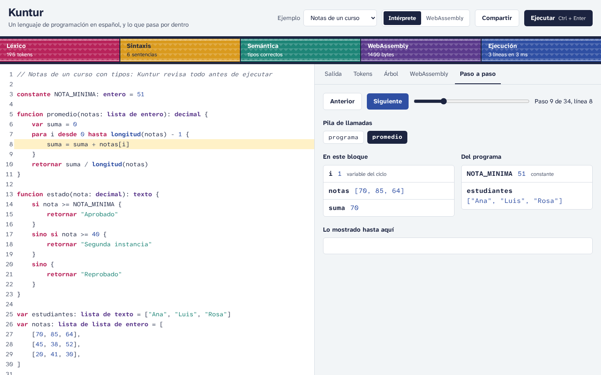

# Kuntur

Lenguaje de programación en español, pensado para aprender cómo funciona un compilador y para enseñar a programar con mensajes de error claros.

```
funcion factorial(n: entero): entero {
    si n <= 1 {
        retornar 1
    }
    retornar n * factorial(n - 1)
}

para i desde 1 hasta 5 {
    mostrar(texto(i) + "! =", factorial(i))
}
```

```
Error semántico en la línea 4, columna 27:
  4 | var mensaje = "Tienes " + edda + " años"
    |                           ^
`edda` no existe. ¿Quisiste decir `edad`?
```

## Playground

En el playground se escribe código en Kuntur y se ve qué hace cada etapa del compilador: una franja de colores, tejida como un aguayo, marca si el código pasó el análisis léxico, la sintaxis, la semántica, la compilación a WebAssembly y la ejecución. Cada etapa abre su vista:

- **Tokens** que produce el analizador léxico.
- **Árbol de sintaxis**, con el papel de cada nodo y el tipo que dedujo el análisis.
- **WebAssembly** generado, para leerlo o descargar el `.wasm`.
- **Paso a paso**: marca la línea que se ejecuta y muestra la pila de llamadas y el valor de cada variable.

Los errores se subrayan mientras se escribe y los programas se comparten con un enlace.



```bash
npm run playground          # Abre el playground en modo desarrollo
npm run playground:build    # Lo compila en playground/dist
```

Al actualizar `main`, el workflow `Publicar playground` lo publica en GitHub Pages.

## Cómo funciona

```
código fuente ──► analizador léxico ──► analizador sintáctico ──► análisis semántico ─┬─► intérprete
                     (tokens)              (árbol de sintaxis)       (nombres y tipos)  │
                                                                                         └─► compilador ──► WebAssembly
```

1. **Analizador léxico** (`src/lexer`): corta el texto en tokens y decide dónde termina cada sentencia según los saltos de línea.
2. **Analizador sintáctico** (`src/parser`): arma el árbol de sintaxis con un parser descendente recursivo y el método de Pratt para la precedencia de los operadores. Se recupera de los errores para informar varios en una sola pasada.
3. **Análisis semántico** (`src/checker`): revisa nombres y tipos antes de ejecutar. Deduce el tipo de las variables sin anotación y deja como desconocido lo que no se puede saber (tipado gradual).
4. **Intérprete** (`src/interpreter`): recorre el árbol y ejecuta el programa, con ámbitos, clausuras y límites contra ciclos infinitos. Sus revisiones de tipos quedan como red de seguridad para los valores desconocidos.
5. **Compilador** (`src/compiler`): traduce el programa a WebAssembly escribiendo el binario byte por byte, sin bibliotecas. El resultado corre unas 15 veces más rápido que el intérprete y da la misma salida. Ver [cómo funciona](docs/webassembly.md).

## Requisitos

- Node.js 22.12 o superior

## Instalación

```bash
npm install
```

## Uso

```bash
npm run kuntur ejemplos/factorial.kun            # Ejecuta un programa
npm run kuntur -- --tokens ejemplos/hola.kun     # Muestra los tokens
npm run kuntur -- --arbol ejemplos/hola.kun      # Muestra el árbol de sintaxis
npm run kuntur -- --wasm ejemplos/tipos.kun      # Compila a WebAssembly y ejecuta
npm run kuntur -- --wat ejemplos/hola.kun        # Muestra el WebAssembly generado
npm run kuntur -- --compilar ejemplos/tipos.kun tipos.wasm   # Guarda el binario
```

También como biblioteca:

```typescript
import {run, formatDiagnostic} from 'kuntur';

const source = 'mostrar("Hola")';
const {output, diagnostics} = run(source);
diagnostics.forEach((diagnostic) => console.error(formatDiagnostic(diagnostic, source)));
```

## Comandos

| Comando | Uso |
|---|---|
| `npm test` | Corre las pruebas |
| `npm run lint` | Valida el estilo del código |
| `npm run typecheck` | Verifica los tipos de TypeScript |
| `npm run build` | Compila a `dist/` |

## Documentación

- [Referencia del lenguaje](docs/lenguaje.md)
- [Compilación a WebAssembly](docs/webassembly.md)
- [Estándares de desarrollo](reglas.md)
- [Programas de ejemplo](ejemplos/)

## Hoja de ruta

| Fase | Contenido | Estado |
|---|---|---|
| 1 | Analizador léxico, analizador sintáctico e intérprete | Terminada |
| 2 | Tipos (`entero`, `decimal`, `texto`, `logico`, `lista de ...`), análisis semántico y errores antes de ejecutar | Terminada |
| 3 | Compilación a WebAssembly | Terminada |
| 4 | Playground web con visualización de tokens, árbol, WebAssembly y ejecución paso a paso | Terminada |
