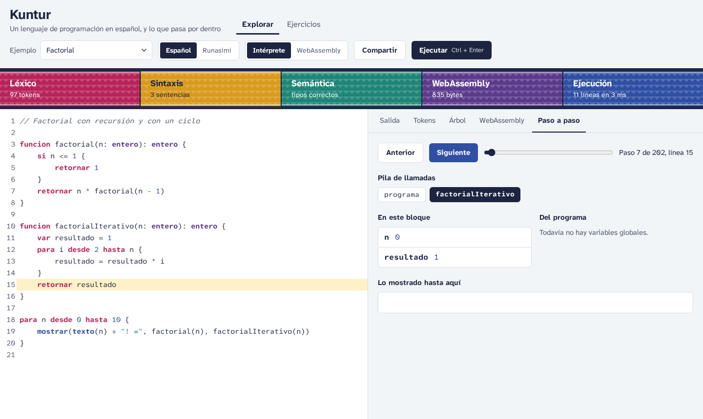

# Kuntur

Lenguaje de programación en español, pensado para aprender a programar con mensajes de error claros y para ver cómo funciona un compilador por dentro. Se escribe en español o en quechua, se ejecuta con un intérprete o compilado a WebAssembly, y se usa desde el navegador, VS Code o la terminal.

**Pruébalo sin instalar nada:** https://mateomerino14.github.io/KUNTUR-LENGUAJE/

```
registro Alumno {
    nombre: texto
    nota: entero
}

var curso = [Alumno("Ana", 85), Alumno("Luis", 48), Alumno("Eva", 72)]
para cada alumno en curso {
    si alumno.nota >= 51 {
        mostrar(alumno.nombre, "aprobó con", alumno.nota)
    }
}
```

```
Error semántico en la línea 4, columna 27:
  4 | var mensaje = "Tienes " + edda + " años"
    |                           ^
`edda` no existe. ¿Quisiste decir `edad`?
```



## Qué incluye

- **Un lenguaje completo para aprender:** variables y constantes, `si`/`sino`, `mientras`, `para` y `para cada`, funciones con recursión, listas, diccionarios, registros, tipos con deducción automática y `leer` para pedir datos.
- **Errores pensados para quien aprende:** se detectan antes de ejecutar, todos juntos, con la línea exacta y sugerencias como "¿Quisiste decir `edad`?".
- **Playground web:** una franja de colores, tejida como un aguayo, muestra cada etapa del compilador. Cada etapa abre su vista: tokens, árbol de sintaxis, WebAssembly generado y ejecución paso a paso con la pila de llamadas y las variables.
- **Ejercicios con corrección automática:** 11 problemas en tres niveles, probados con casos visibles y ocultos. El progreso se guarda en el navegador.
- **Compilación a WebAssembly** escrita byte por byte, sin bibliotecas. Hay una versión independiente que lleva su propio runtime y corre con `wasmtime`, sin JavaScript.
- **Modo quechua (runasimi):** las palabras del lenguaje en quechua (`sichus`, `kaykama`, `rikuchiy`...), con traducción automática entre los dos idiomas.
- **Extensión para VS Code:** colores, errores mientras se escribe, ejecución con `Ctrl + Enter`, fragmentos y comandos para WebAssembly y traducción.

## Documentación

- **[Manual de usuario](docs/manual.md)**: cómo usar Kuntur paso a paso, para quien empieza.
- [Referencia del lenguaje](docs/lenguaje.md)
- [Ejercicios con corrección automática](docs/ejercicios.md)
- [Modo quechua (runasimi)](docs/quechua.md)
- [Extensión para VS Code](docs/vscode.md)
- [Compilación a WebAssembly](docs/webassembly.md)
- [Estándares de desarrollo](reglas.md)
- [Programas de ejemplo](ejemplos/)

## Cómo funciona

```
                                                                                     ┌─► intérprete
código fuente ──► analizador léxico ──► analizador sintáctico ──► análisis semántico ─┤
                     (tokens)              (árbol de sintaxis)       (nombres y tipos)  └─► compilador ──► WebAssembly
```

1. **Analizador léxico** (`src/lexer`): corta el texto en tokens y decide dónde termina cada sentencia según los saltos de línea. En modo quechua reconoce las palabras en quechua y las convierte en los mismos tokens.
2. **Analizador sintáctico** (`src/parser`): arma el árbol de sintaxis con un parser descendente recursivo y el método de Pratt para la precedencia de los operadores. Se recupera de los errores para informar varios en una sola pasada.
3. **Análisis semántico** (`src/checker`): revisa nombres y tipos antes de ejecutar. Deduce el tipo de las variables sin anotación y deja como desconocido lo que no se puede saber (tipado gradual).
4. **Intérprete** (`src/interpreter`): recorre el árbol y ejecuta el programa, con ámbitos, clausuras y límites contra ciclos infinitos.
5. **Compilador** (`src/compiler`): traduce el programa a WebAssembly. La versión para el navegador usa funciones de JavaScript; la versión independiente (WASI) trae su propio runtime en WebAssembly, con memoria, textos, listas, diccionarios y formato exacto de números. Ver [cómo funciona](docs/webassembly.md).

Las pruebas exigen que el intérprete, el WebAssembly del navegador y el WebAssembly independiente den exactamente la misma salida y los mismos errores.

## Instalación

Solo hace falta para usar la terminal o modificar el proyecto. Requiere Node.js 22.12 o superior.

```bash
npm install
```

## Uso desde la terminal

```bash
npm run kuntur ejemplos/factorial.kun            # Ejecuta un programa
npm run kuntur ejemplos/promedio.kun             # Pide los datos con leer() y espera las respuestas
npm run kuntur -- --tokens ejemplos/hola.kun     # Muestra los tokens
npm run kuntur -- --arbol ejemplos/hola.kun      # Muestra el árbol de sintaxis
npm run kuntur -- --wasm ejemplos/tipos.kun      # Compila a WebAssembly y ejecuta
npm run kuntur -- --wat ejemplos/hola.kun        # Muestra el WebAssembly generado
npm run kuntur -- --wasi ejemplos/tipos.kun      # Compila a WebAssembly independiente y ejecuta
npm run kuntur -- --compilar ejemplos/tipos.kun tipos.wasm   # Guarda el WebAssembly independiente
wasmtime tipos.wasm                              # Lo ejecuta sin Node ni Kuntur
npm run kuntur -- --runasimi programa.kun        # Ejecuta un programa escrito en quechua
```

## Uso como biblioteca

```typescript
import {run, formatDiagnostic, translateSource} from 'kuntur';

const source = 'mostrar("Hola")';
const {output, diagnostics} = run(source);
diagnostics.forEach((diagnostic) => console.error(formatDiagnostic(diagnostic, source)));

const quechua = translateSource(source, 'qu');   // 'rikuchiy("Hola")'
run(quechua, {language: 'qu'});
```

`tokenize`, `parse`, `check`, `compile` y `runCompiled` también están disponibles. Ninguna lanza excepciones: todas devuelven su resultado junto con la lista de `diagnostics`.

## Extensión para VS Code

Descarga [`kuntur.vsix`](https://github.com/mateomerino14/KUNTUR-LENGUAJE/releases/download/vscode-v0.1.0/kuntur.vsix) y en VS Code elige **Extensiones → ... → Instalar desde VSIX...**. Ver la [guía de la extensión](docs/vscode.md).

## Comandos de desarrollo

| Comando | Uso |
|---|---|
| `npm test` | Corre las pruebas |
| `npm run lint` | Valida el estilo del código |
| `npm run typecheck` | Verifica los tipos de TypeScript del compilador, el playground y la extensión |
| `npm run build` | Compila la biblioteca a `dist/` |
| `npm run playground` | Abre el playground en modo desarrollo |
| `npm run playground:build` | Compila el playground en `playground/dist` |
| `npm run vscode:test` | Prueba la extensión dentro de VS Code (en Linux sin pantalla: `xvfb-run -a`) |
| `npm run vscode:package` | Genera `vscode/kuntur.vsix` |

Con cada cambio en `main`, GitHub Actions publica el playground en GitHub Pages y la extensión en un release.

## Estructura

```
src/          Compilador: léxico, sintaxis, semántica, intérprete, WebAssembly, ejercicios e idiomas
playground/   Aplicación web (React, Vite, Tailwind y CodeMirror)
vscode/       Extensión para VS Code
tests/        Pruebas con Vitest
ejemplos/     Programas de ejemplo
docs/         Manual y documentación
```

## Hoja de ruta

| Fase | Contenido | Estado |
|---|---|---|
| 1 | Analizador léxico, analizador sintáctico e intérprete | Terminada |
| 2 | Tipos, análisis semántico y errores antes de ejecutar | Terminada |
| 3 | Compilación a WebAssembly | Terminada |
| 4 | Playground web con tokens, árbol, WebAssembly y ejecución paso a paso | Terminada |
| 5 | Ejecutable `.wasm` independiente con WASI | Terminada |
| 6 | Ejercicios con corrección automática | Terminada |
| 7 | `para cada`, diccionarios y registros | Terminada |
| 8 | Modo quechua | Terminada |
| 9 | Extensión para VS Code | Terminada |
| 10 | Manual de usuario | Terminada |

## Autor

Mateo Alejandro Merino Vidal. Licencia MIT.
