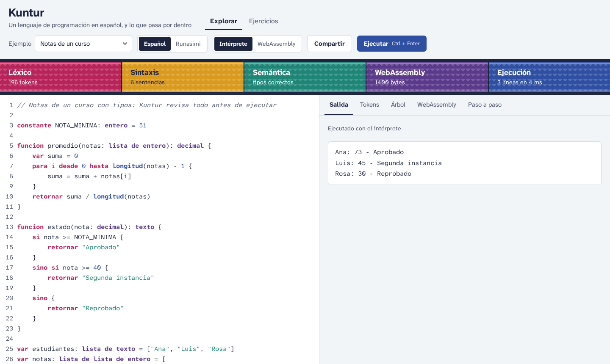
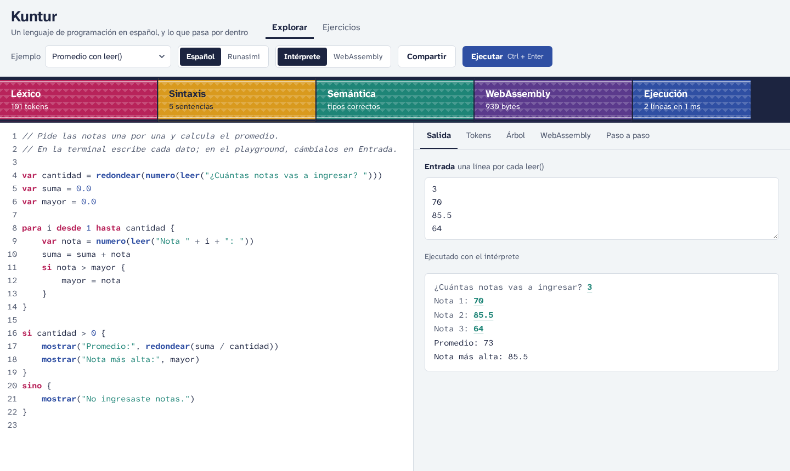
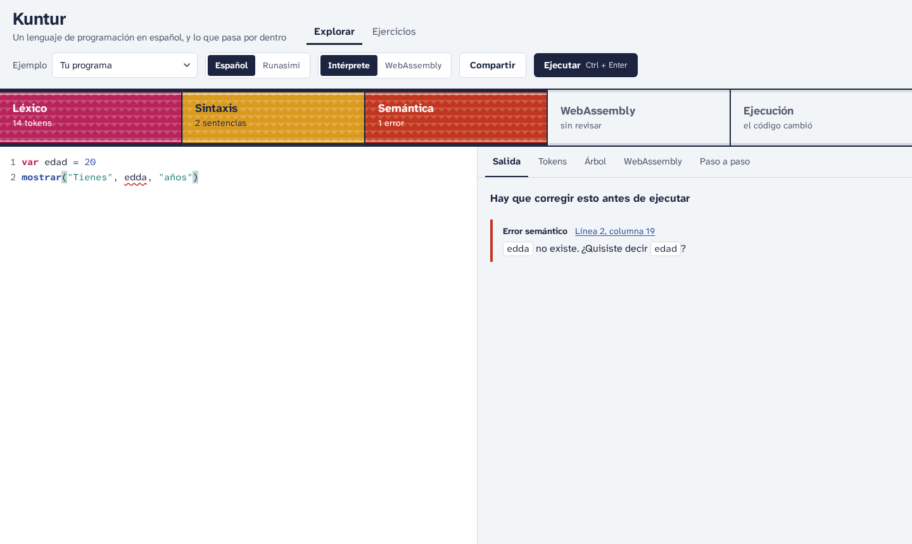
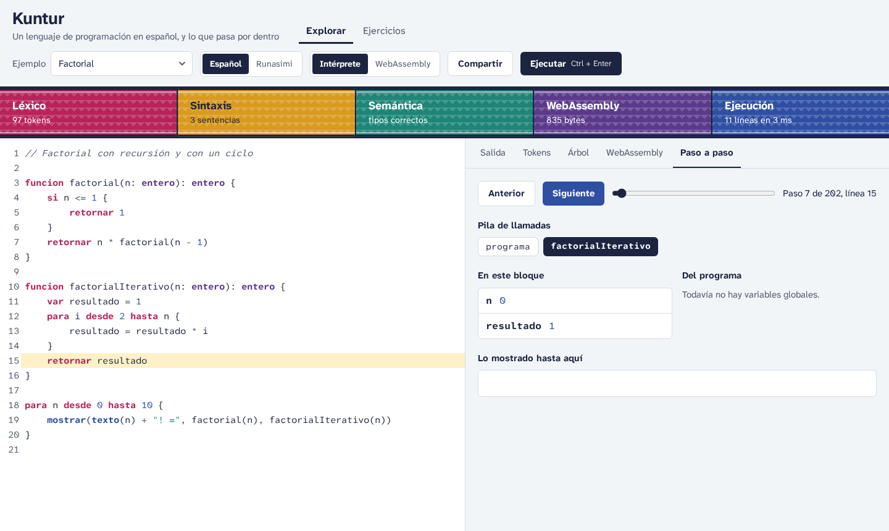
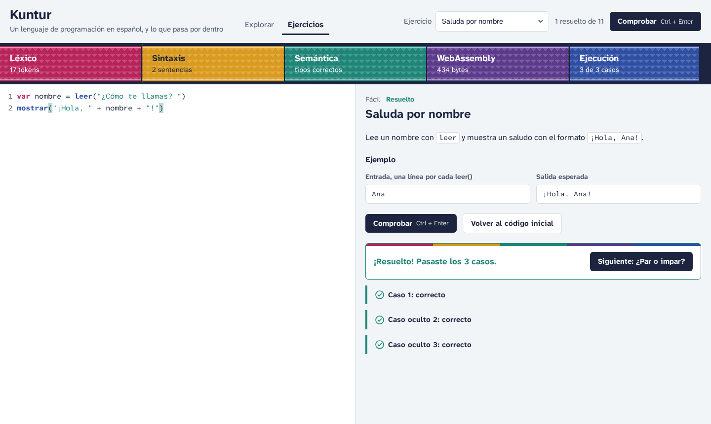
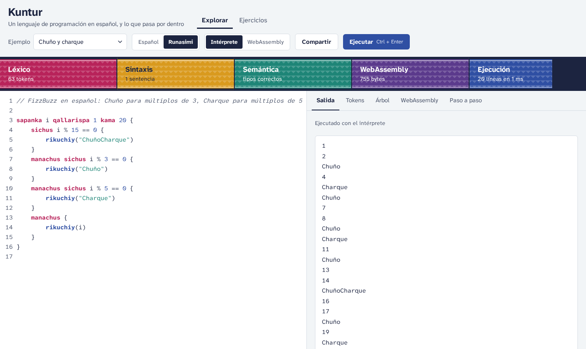

# Manual de usuario de Kuntur

Kuntur es un lenguaje de programación con palabras en español, pensado para aprender a programar y para ver qué hace un compilador por dentro. Este manual explica cómo usarlo, sin necesidad de saber programar de antemano.

**Contenido**

1. [Empezar en un minuto](#1-empezar-en-un-minuto)
2. [La pantalla del playground](#2-la-pantalla-del-playground)
3. [Tu primer programa](#3-tu-primer-programa)
4. [Lo básico del lenguaje](#4-lo-básico-del-lenguaje)
5. [Pedir datos con leer](#5-pedir-datos-con-leer)
6. [Entender los errores](#6-entender-los-errores)
7. [Ver el programa paso a paso](#7-ver-el-programa-paso-a-paso)
8. [Practicar con ejercicios](#8-practicar-con-ejercicios)
9. [Compartir un programa](#9-compartir-un-programa)
10. [Escribir en quechua](#10-escribir-en-quechua)
11. [Usar Kuntur en VS Code](#11-usar-kuntur-en-vs-code)
12. [Usar Kuntur en la terminal](#12-usar-kuntur-en-la-terminal)
13. [Problemas frecuentes](#13-problemas-frecuentes)
14. [Hoja de referencia](#14-hoja-de-referencia)

---

## 1. Empezar en un minuto

1. Abre el playground: **https://mateomerino14.github.io/KUNTUR-LENGUAJE/**
2. Presiona **Ejecutar** (o `Ctrl + Enter`). A la derecha aparece lo que muestra el programa.
3. Cambia el texto entre comillas de `mostrar(...)` y vuelve a ejecutar.

No hace falta instalar nada ni crear una cuenta. Funciona en cualquier navegador moderno, también en el celular.

## 2. La pantalla del playground



| Parte | Para qué sirve |
|---|---|
| **Explorar / Ejercicios** | Cambia entre escribir programas libres y resolver ejercicios |
| **Ejemplo** | Carga programas listos, agrupados por tema |
| **Español / Runasimi** | Elige el idioma de las palabras del lenguaje |
| **Intérprete / WebAssembly** | Elige cómo se ejecuta el programa; el resultado es el mismo |
| **Compartir** | Copia un enlace con tu programa |
| **Ejecutar** | Corre el programa |
| **Franja de colores** | Muestra cada etapa del compilador. Si una etapa se pone roja, ahí está el error. Cada etapa abre su vista al hacer clic |
| **Editor** (izquierda) | Donde se escribe el código |
| **Pestañas** (derecha) | Salida, tokens, árbol, WebAssembly y paso a paso |

Las pestañas muestran lo que pasa por dentro:

- **Salida:** lo que muestra el programa.
- **Tokens:** las piezas en que el compilador corta el texto (palabras, números, signos).
- **Árbol:** cómo entiende el compilador la estructura del programa, con el tipo de cada valor.
- **WebAssembly:** el programa traducido al lenguaje que entiende el navegador. Desde ahí se puede descargar como `.wasm`.
- **Paso a paso:** recorre la ejecución línea por línea.

## 3. Tu primer programa

Borra lo que hay en el editor y escribe:

```
var nombre = "Cochabamba"
mostrar("¡Hola,", nombre + "!")
```

Presiona **Ejecutar**. Verás:

```
¡Hola, Cochabamba!
```

- `var nombre = "Cochabamba"` guarda un texto con el nombre `nombre`.
- `mostrar(...)` muestra valores en una línea, separados por un espacio.
- `+` une dos textos.

## 4. Lo básico del lenguaje

### Variables

```
var edad = 20
edad = edad + 1
constante PI = 3.1416
```

Una variable se declara una vez con `var` y luego se cambia sin `var`. Una `constante` no se puede cambiar.

### Tipos de valores

| Tipo | Ejemplos |
|---|---|
| `entero` | `42`, `-7` |
| `decimal` | `3.5`, `2.0` |
| `texto` | `"hola"` |
| `logico` | `verdadero`, `falso` |
| lista | `[70, 85, 40]` |
| diccionario | `{"Ana": 20, "Luis": 18}` |

Kuntur deduce el tipo solo. Si quieres, puedes escribirlo: `var edad: entero = 20`.

### Decisiones con `si`

```
var nota = 65
si nota >= 51 {
    mostrar("Aprobado")
}
sino {
    mostrar("Reprobado")
}
```

Para unir condiciones se usa `y` y `o`; para negarlas, `no`.

### Repetir con `para` y `mientras`

```
para i desde 1 hasta 5 {
    mostrar(i)
}

var saldo = 50
mientras saldo > 0 {
    saldo = saldo - 20
}
```

Para recorrer una lista se usa `para cada`:

```
para cada nota en [70, 85, 40] {
    mostrar(nota)
}
```

### Funciones

```
funcion area(base, altura) {
    retornar base * altura / 2
}

mostrar(area(4, 3))
```

### Listas y diccionarios

```
var notas = [70, 85, 40]
agregar(notas, 90)
mostrar(notas[0], longitud(notas))   // 70 4

var precios = {"papa": 6.5, "locoto": 2.5}
precios["tomate"] = 5
mostrar(precios["papa"])             // 6.5
```

Las posiciones de una lista empiezan en 0.

### Registros

Un registro agrupa datos, como una ficha:

```
registro Alumno {
    nombre: texto
    nota: entero
}

var a = Alumno("Ana", 85)
mostrar(a.nombre, a.nota)
```

La [referencia del lenguaje](lenguaje.md) explica todo con más detalle.

## 5. Pedir datos con leer

`leer` hace una pregunta y devuelve lo que se responde, siempre como texto. Para usarlo como número se convierte con `numero`:

```
var nombre = leer("¿Cómo te llamas? ")
var edad = numero(leer("¿Cuántos años tienes? "))
mostrar("Hola,", nombre + ". En 10 años tendrás", edad + 10)
```

En el playground, cuando el programa usa `leer`, aparece el cuadro **Entrada**. Escribe ahí las respuestas, **una por línea**, antes de ejecutar. La salida muestra la conversación completa, con las respuestas resaltadas.



## 6. Entender los errores

Kuntur revisa el programa **mientras escribes**. Si encuentra un error:

- Subraya en rojo el lugar del error en el editor.
- La etapa de la franja donde está el error se pone roja.
- En **Salida** aparece el mensaje, con la línea y la columna. Al hacer clic en "Línea..., columna..." el editor salta a ese lugar.



Los mensajes explican qué pasó y, cuando pueden, sugieren la corrección. Hay tres clases de errores:

| Error | Qué significa | Ejemplo |
|---|---|---|
| De sintaxis | Algo está mal escrito | Falta una `}` |
| Semántico | Está bien escrito pero no tiene sentido | Usar una variable que no existe, o sumar un texto con una lista |
| De ejecución | Ocurre al correr el programa | Dividir entre cero, o leer la posición 10 de una lista de 3 |

Los errores de sintaxis y semánticos impiden ejecutar: hay que corregirlos primero.

## 7. Ver el programa paso a paso

1. Abre la pestaña **Paso a paso** y presiona **Ejecutar paso a paso**.
2. Usa **Siguiente** y **Anterior**, o arrastra la barra.
3. El editor resalta la línea que se está ejecutando. A la derecha se ven las funciones que están en curso (la pila de llamadas), el valor de cada variable y lo que se mostró hasta ese momento.



Sirve para entender por qué un programa da un resultado inesperado.

## 8. Practicar con ejercicios

En **Ejercicios** hay 11 problemas en tres niveles: Fácil, Intermedio y Desafío.

1. Elige un ejercicio en el selector de arriba.
2. Lee el enunciado y los ejemplos.
3. Escribe tu solución en el editor.
4. Presiona **Comprobar** (`Ctrl + Enter`).

Tu programa se prueba con los ejemplos y con otros casos ocultos. Si un caso falla, ves lo que se esperaba junto a lo que mostró tu programa, con la primera línea distinta marcada.



Algunos consejos:

- La salida debe ser **exactamente** la pedida: mayúsculas, espacios y signos cuentan.
- Las preguntas de `leer` no cuentan como salida.
- Tu progreso y tu código quedan guardados en el navegador, aunque cierres la página.
- **Volver al código inicial** borra tu solución de ese ejercicio.

## 9. Compartir un programa

Presiona **Compartir**: se copia un enlace con tu código, las respuestas de **Entrada** y el idioma. Quien lo abra verá tu programa listo para ejecutar. No se guarda nada en ningún servidor; todo va dentro del enlace.

Cada ejercicio también tiene su enlace, por ejemplo `.../#ejercicio=fibonacci`.

## 10. Escribir en quechua

Elige **Runasimi** arriba. El programa del editor se traduce solo:

```
sapanka i qallarispa 1 kama 5 {
    sichus i % 2 == 0 {
        rikuchiy(i, "par")
    }
}
```



| Español | Runasimi | Español | Runasimi |
|---|---|---|---|
| `var` | `kay` | `para` | `sapanka` |
| `constante` | `mana tikraq` | `desde` / `hasta` | `qallarispa` / `kama` |
| `funcion` | `ruray` | `romper` / `continuar` | `p'akiy` / `qatiy` |
| `retornar` | `kutichiy` | `verdadero` / `falso` | `cheqaq` / `llulla` |
| `si` / `sino` | `sichus` / `manachus` | `nulo` | `ch'usaq` |
| `mientras` | `kaykama` | `y` / `o` / `no` | `chantapas` / `utaq` / `mana` |
| `mostrar` | `rikuchiy` | `leer` | `tapuy` |

Al volver a **Español**, el programa se traduce de vuelta. Más detalles en [modo quechua](quechua.md).

## 11. Usar Kuntur en VS Code

1. Descarga [`kuntur.vsix`](https://github.com/mateomerino14/KUNTUR-LENGUAJE/releases/download/vscode-v0.1.0/kuntur.vsix).
2. En VS Code abre **Extensiones** (`Ctrl + Shift + X`), presiona **...** y elige **Instalar desde VSIX...**.
3. Crea un archivo que termine en `.kun` y escribe tu programa.

Con la extensión:

- El código tiene colores y los errores se subrayan mientras escribes.
- **Ejecutar:** presiona ▶ arriba a la derecha o `Ctrl + Enter`. Se abre una terminal donde se responde a cada `leer`.
- Con `Ctrl + Shift + P` y la palabra "Kuntur" aparecen más comandos: ver el WebAssembly, guardar el `.wasm` y traducir entre español y quechua.
- Al escribir `si`, `para`, `funcion` o `registro` y presionar Tab, se completa la estructura.

Para escribir en quechua, cambia la configuración **Kuntur: Idioma** a `runasimi`. Más detalles en [extensión para VS Code](vscode.md).

## 12. Usar Kuntur en la terminal

Esta opción es para quien tiene [Node.js](https://nodejs.org) 22.12 o superior y descargó el proyecto:

```bash
npm install
npm run kuntur mi_programa.kun                     # Ejecuta un programa
npm run kuntur -- --runasimi mi_programa.kun       # Programa escrito en quechua
npm run kuntur -- --compilar mi_programa.kun mi_programa.wasm   # Lo guarda como WebAssembly
```

Cuando el programa usa `leer`, la terminal espera que escribas cada respuesta y presiones Enter. El `.wasm` guardado se ejecuta con [wasmtime](https://wasmtime.dev), sin Node ni Kuntur: `wasmtime mi_programa.wasm`.

## 13. Problemas frecuentes

**"Ya no hay más datos de entrada" al ejecutar.** El programa pide más datos con `leer` de los que hay en **Entrada**. Agrega una respuesta por línea.

**No puedo guardar decimales en mi variable.** Si la variable empezó con un entero (`var total = 0`), su tipo es entero. Empiézala con `0.0` o declárala con `: decimal`.

**`y`, `o` o `si` no sirven como nombre.** Son palabras del lenguaje. Elige otro nombre, por ejemplo `y1` o `valor_y`.

**"El programa superó el límite de pasos".** Probablemente hay un ciclo que nunca termina. Revisa que la condición del `mientras` cambie dentro del ciclo.

**WebAssembly dice que algo no se puede compilar.** Algunas cosas, como funciones dentro de otras funciones o listas sin tipo, solo funcionan con el intérprete. Cambia a **Intérprete**, o agrega el tipo: `var lista: lista de entero = []`.

**Mi progreso de ejercicios desapareció.** Se guarda en el navegador. En modo privado, o al borrar los datos del navegador, se pierde.

## 14. Hoja de referencia

```
// Comentario
var x = 10                      constante PI = 3.14
var lista = [1, 2, 3]           var edades = {"Ana": 20}

si x > 5 {                      mientras x > 0 {
    ...                             x = x - 1
}                               }
sino si x == 5 { ... }
sino { ... }                    para i desde 1 hasta 10 paso 2 { ... }
                                para cada elemento en lista { ... }
funcion doble(n) {
    retornar n * 2              romper      // sale del ciclo
}                               continuar   // pasa a la siguiente vuelta

registro Punto { x: decimal, y_: decimal }
var p = Punto(1, 2)             mostrar(p.x)
```

| Función | Qué hace |
|---|---|
| `mostrar(a, b, ...)` | Muestra los valores en una línea |
| `leer("pregunta")` | Pregunta y devuelve la respuesta como texto |
| `numero(texto)` | Convierte `"42"` en el número 42 |
| `texto(valor)` | Convierte un valor en texto |
| `redondear(x)` | Redondea al entero más cercano |
| `raiz(x)` | Raíz cuadrada |
| `aleatorio(min, max)` | Entero al azar entre los dos, incluidos |
| `longitud(x)` | Elementos de una lista, letras de un texto o claves de un diccionario |
| `agregar(lista, valor)` | Agrega al final de la lista |
| `quitar(lista)` | Quita y devuelve el último elemento |
| `tiene(dicc, clave)` | Indica si el diccionario tiene la clave |
| `claves(dicc)` | Lista con las claves del diccionario |
| `tipo(x)` | Nombre del tipo del valor |

| Operadores | |
|---|---|
| Aritméticos | `+` `-` `*` `/` `%` (residuo) |
| Comparación | `==` `!=` `<` `<=` `>` `>=` |
| Lógicos | `y` `o` `no` |
